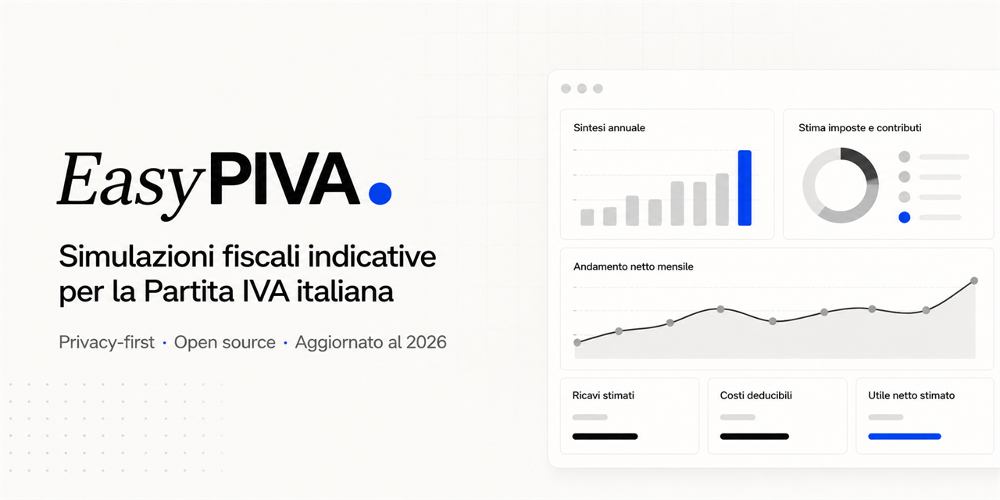

# EasyPIVA 2026

Indicative tax simulations for the Italian Partita IVA (sole proprietorship)

[](https://github.com/TheStreamCode/easypiva/actions/workflows/ci.yml)
[](https://github.com/TheStreamCode/easypiva/releases)
[](LICENSE)



[Italiano](README.md) · **English**

EasyPIVA is an open-source web app for indicative tax simulations for the Italian Partita IVA (sole proprietorship). It combines flat-rate regime (regime forfettario) calculations, INPS contributions, a comparison with the ordinary regime, revenue planning, and quote generation with PDF export.

Independent project: it is not affiliated with INPS, the Agenzia delle Entrate, or other public bodies.

> The results are indicative estimates and do not constitute tax, legal, or accounting advice. For professional decisions, consult a qualified advisor.

## Install

EasyPIVA requires no installation: open [easypiva.vercel.app](https://easypiva.vercel.app) in a modern browser. No account, application backend, or server-side configuration is required.

To run a local copy of the app, see [Development](#development).

## Quick start

1. Open [EasyPIVA](https://easypiva.vercel.app).
2. Open the flat-rate regime calculator and enter revenue, the ATECO coefficient, and the INPS scheme.
3. Read the estimated net income and compare the result with the ordinary regime.
4. Fill in a quote, save it in the browser, or export it as a PDF.

## Features

- 2026 flat-rate regime (regime forfettario) calculation.
- Indicative comparison between the flat-rate regime and the ordinary regime.
- INPS contribution simulation for Gestione Separata, Artigiani, and Commercianti.
- Reverse calculation of the revenue needed to reach a target net income.
- Monthly revenue planning against the regime thresholds.
- Local quote with A4 preview, browser autosave, and PDF export.

### Reliability and limits

- thresholds, rates, and coefficients are centralized in `src/lib/fiscal-data.ts`;
- tax logic is isolated in pure functions under `src/lib/calculations/`;
- assumptions and legal sources are documented in the [fiscal ADR](docs/ADRs/0001-fiscal-assumptions.md) and the [public information page](https://easypiva.vercel.app/informativa);
- unit, UI, and end-to-end tests protect the main regression cases;
- every fiscal change requires coordinated updates to code, tests, documentation, and public copy.

## Requirements

- A modern browser with JavaScript enabled, in an up-to-date version of Chrome, Edge, or Firefox.
- The published app requires no account, application backend, or environment variables.
- For development: Node.js 24 LTS and npm 11.

## Configuration

EasyPIVA exposes no server-side settings. The preferences saved in the browser are:

| Setting            | Purpose                                                   | Default      |
| ------------------ | --------------------------------------------------------- | ------------ |
| Theme              | Toggles the light and dark interface and keeps the choice | System theme |
| Disclaimer consent | Stores the acceptance of the disclaimer notice            | Not stored   |
| Quote draft        | Autosaves the quote being edited in the browser           | No draft     |
| Quote logo         | Embeds a PNG, JPEG, or WebP logo up to 1 MB               | No logo      |

Preferences are stored only in the browser's `localStorage`. The app does not send entered values to a server and does not use accounts or telemetry.

## Privacy and security

The project follows a local-first architecture: values entered in the simulators and in the quote are not sent to a server. Theme, disclaimer consent, and quote draft may be stored in the browser's `localStorage`; details are in [Privacy and local storage](docs/privacy-and-storage.md).

All calculations run locally in the browser and the 2026 fiscal assumptions are centralized and tested. The repository uses CI with minimal permissions, GitHub Actions pinned to commit SHAs, and Dependency Review on pull requests that change dependencies. To report a vulnerability privately, follow [SECURITY.md](SECURITY.md); do not open a public issue.

## Troubleshooting

### Results differ from my accountant's. Why?

EasyPIVA produces indicative estimates based on the 2026 fiscal assumptions documented in the [fiscal ADR](docs/ADRs/0001-fiscal-assumptions.md) and the [public information page](https://easypiva.vercel.app/informativa), with thresholds, rates, and coefficients centralized in `src/lib/fiscal-data.ts`. A professional can apply deductions, reliefs, or personal situations (other income, benefits, advance payments) that the simulator does not know about. If the values diverge, compare the inputs with the published assumptions and, for professional decisions, always rely on a qualified advisor.

### Which INPS scheme applies to my case?

The app simulates three schemes: Gestione Separata, Artigiani, and Commercianti, with the 2026 values (INPS Circular 8/2026 for Gestione Separata, 14/2026 for Artigiani and Commercianti). For Artigiani and Commercianti the annual ceiling depends on the contribution seniority at 1995-12-31: 93,707 EUR for those already registered, 122,295 EUR for the others. The correct scheme depends on your activity and on registration with the Chamber of Commerce or a professional register: when in doubt, verify your position with INPS or an advisor.

### The PDF quote export does not work. What can I do?

The export happens entirely in the browser (jsPDF with rendering through html2canvas): make sure you are using an up-to-date version of Chrome, Edge, or Firefox, that downloads are not blocked for the site, and that there is enough space for the file. If you uploaded a custom logo, try a lighter file (a small PNG or JPEG). If the problem persists, reload the page — the quote draft is autosaved in `localStorage` — and retry; for reproducible reports, open an issue following [CONTRIBUTING.md](CONTRIBUTING.md).

## Development

Requires Node.js 24 LTS and npm 11; npm is the canonical package manager, and `.nvmrc` and `package.json` are the sources of truth for the versions.

```bash
git clone https://github.com/TheStreamCode/easypiva.git
cd easypiva
npm ci
npm run dev
```

The app is served at `http://127.0.0.1:3000`.

```bash
npm run ci
npm audit
```

`npm run ci` runs formatting, typecheck, lint, Vitest tests, the production build, and Playwright tests. If Chromium is not installed yet, run `npx playwright install chromium` once. The available scripts are documented in `package.json`; the main ones are `dev`, `dev:e2e`, `typecheck`, `lint`, `test`, `test:e2e`, `build`, and `ci`.

Stack: React 19, React Router 8, TypeScript 6, and Vite 6; Tailwind CSS v4 and shadcn/ui components; Zustand, React Hook Form, and Zod; Recharts, motion, and jsPDF; Vitest with jsdom and Playwright with Chromium.

The static build produced in `dist/` is published to [Vercel](https://easypiva.vercel.app) from the `main` branch. `vercel.json` handles client-side routing and the HTTP security headers; the project uses no application backend and no runtime environment variables.

Repository documentation:

- [Architecture](docs/architecture.md)
- [Privacy and local storage](docs/privacy-and-storage.md)
- [Fiscal assumptions](docs/ADRs/0001-fiscal-assumptions.md)
- [Repository governance](docs/repository-governance.md)
- [Asset provenance](docs/asset-provenance.md)
- [Changelog](CHANGELOG.md)

## Support

- Reproducible reports and accessibility or privacy problems: GitHub issues using the bug report form.
- Reports about the fiscal assumptions: issues with verifiable primary sources.
- Vulnerabilities: [SECURITY.md](SECURITY.md), never a public issue.
- Operational contacts: [info@mikesoft.it](mailto:info@mikesoft.it).
- The repository does not provide tax advice, personalized assistance, or operational support.

## Contributing

The repository is public under the MIT license, but maintenance follows a maintainers-only workflow: read [CONTRIBUTING.md](CONTRIBUTING.md) and the [Code of Conduct](CODE_OF_CONDUCT.md) before opening a report. External pull requests are not part of the official maintenance process.

## License

This project is distributed under the [MIT License](LICENSE).

---

Maintained by [Michael Gasperini (Mikesoft)](https://mikesoft.it). If this project is useful to you, consider [sponsoring its maintenance](https://github.com/sponsors/TheStreamCode).
